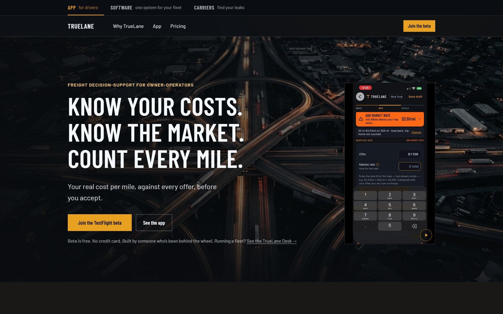
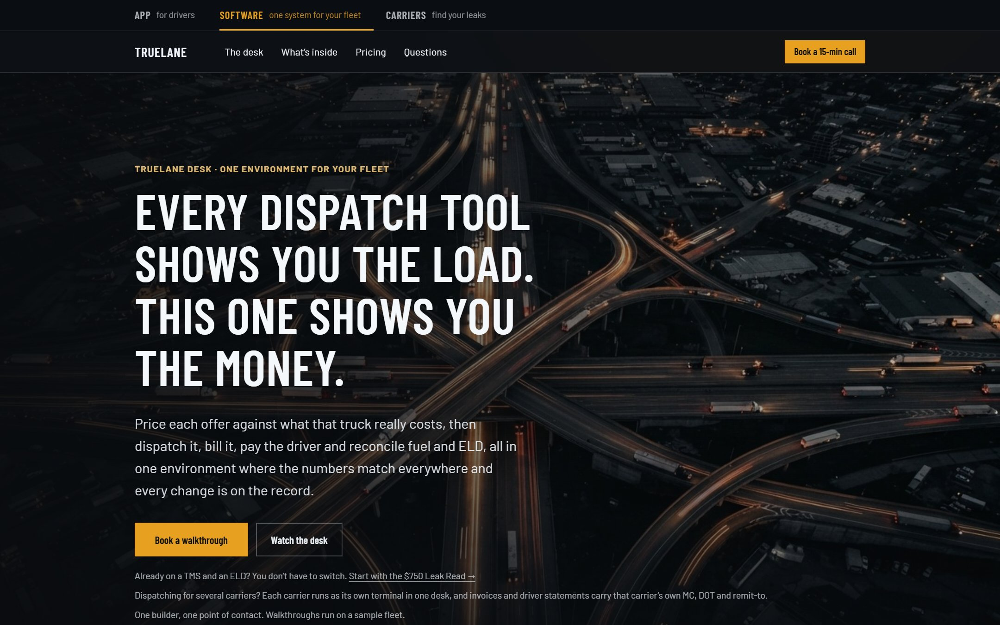
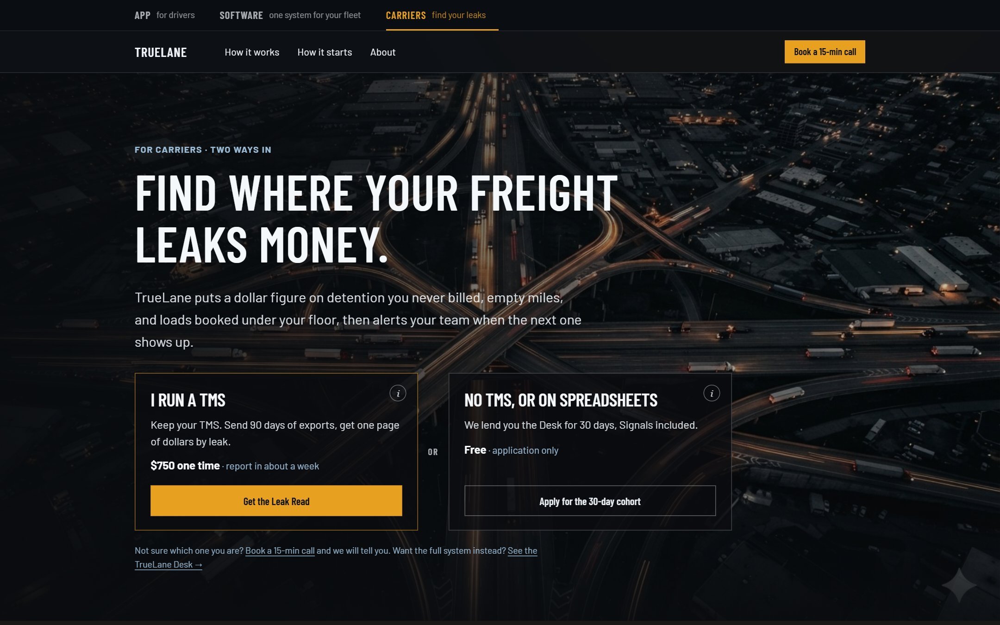
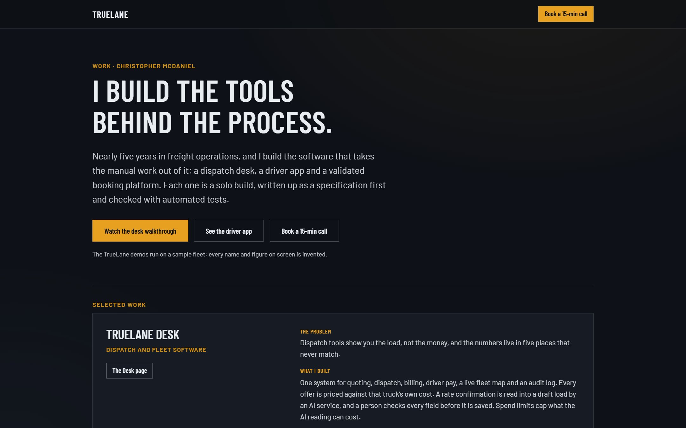
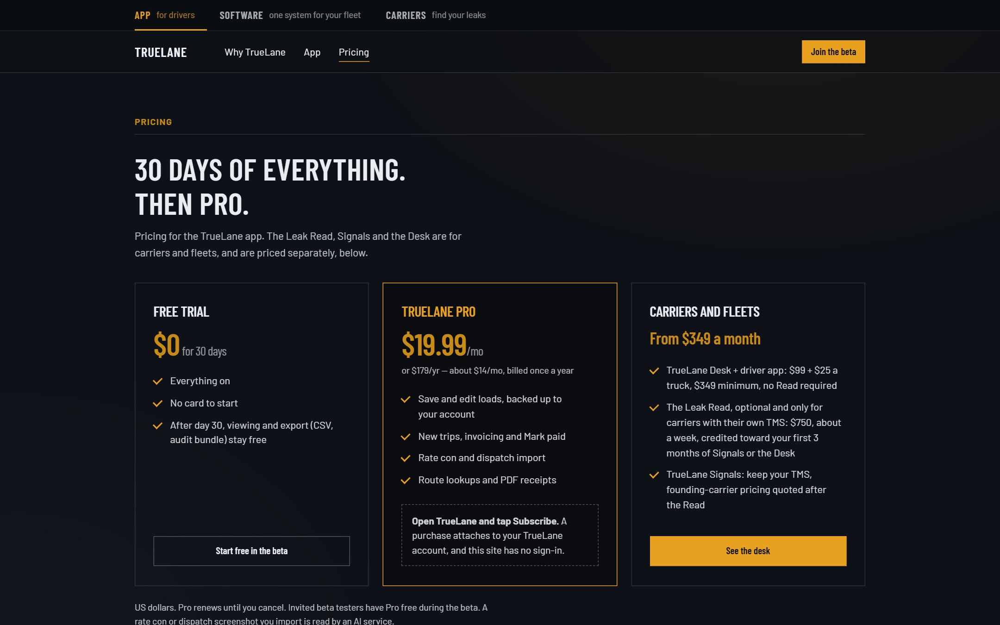
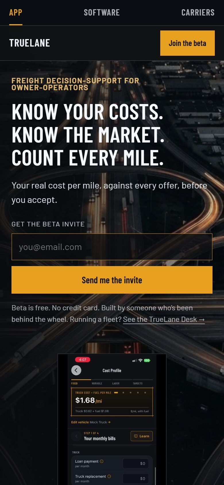

# TrueLane Website

**A fast, hand-built marketing site: three audiences, one design system, no framework.**
The live site for TrueLane, built and written by one person, and a working example of the sites I build for other businesses.

[Live site](https://truelane-three.vercel.app) · [Pages](#the-pages) · [How it is built](#how-it-is-built) · [Websites as a service](#want-a-site-like-this)

---

## What this is

The site that sells [TrueLane](https://truelane-three.vercel.app): a driver app for owner-operators, a dispatch desk for fleets, and a data service for carriers. It has to speak to three different buyers without confusing any of them, load fast on a phone at a truck stop, and turn a visit into a booked call. This repository is the full source of that site.

## The pages

| | |
| --- | --- |
|  **Home.** For drivers: the headline, a phone showing the product, and the beta invite. |  **The Desk.** For fleets and dispatchers: what is inside, pricing and questions. |
|  **Carriers.** Two clear ways in, sorted by whether the visitor runs a TMS. |  **Work.** A portfolio page with the problem, what was built and proof for each project. |
|  **Pricing.** One plain page, no tricks. |  **On a phone.** The same pages, rebuilt for one thumb. |

## How it is built

- **Plain HTML, CSS and a little JavaScript.** No framework, no build step, no dependencies to go stale. It loads fast and will still work in ten years.
- **One design system.** Shared tokens for colour, type and spacing, so every page feels like the same product.
- **Dark by default, readable everywhere.** Strong contrast, keyboard focus states, reduced-motion support and a layout that holds from a phone to a wide monitor.
- **Short copy, one job per page.** The words were written alongside the design, not after it.
- **Video that behaves.** Product clips play in a phone frame that opens full screen, with posters on phones and nothing downloaded until it is needed.
- **Forms that work.** Intake and beta-invite forms post to a form service, with a spam trap and a clear confirmation or error message.
- **Ready to share.** Titles, descriptions and a share card for each page, so a link looks right when it is pasted into a message or a post.
- **Hosted on Vercel**, with redirects for other domains kept in the config.

## Run it

It is a folder of static files. Open `site/index.html` in a browser, or serve the folder with any static server. To deploy, point a Vercel project at `site/`.

The contact forms have their access key replaced with `YOUR_WEB3FORMS_ACCESS_KEY`. Put your own key from [web3forms.com](https://web3forms.com) in each `<form>` to make them send. The product videos are not included; the video slots stay hidden until their files exist.

## Want a site like this?

I build and edit websites for small and mid-sized businesses, especially in freight, logistics and field services: a clear page that explains what you do, looks credible and gets people to call.

- A marketing site or landing page, from copy to launch
- Redesign or cleanup of a site you already have
- Booking and intake forms that actually reach you
- Speed, mobile and search-sharing fixes
- Ongoing edits when you need a change

**Christopher McDaniel** · Dallas–Fort Worth
[LinkedIn](https://www.linkedin.com/in/build-with-chris) · [Book a 15-minute call](https://calendly.com/cm145571/new-meeting) · c.mcdaniel.tx@outlook.com

---

© 2026 TrueLane. The site's code is shared here for viewing and reference. The TrueLane name, logo, copy and images are not licensed for reuse. See [LICENSE](LICENSE).
